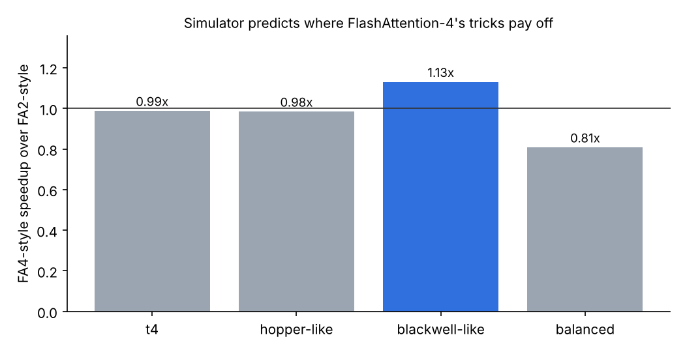

# Alien Silicon

**Can an AI invent fast code for a chip nobody has ever programmed?**

[](https://github.com/Soulfullmens/alien-silicon/actions/workflows/ci.yml)
[](LICENSE)

[](#break-the-judge)

New AI chips can have great hardware and still sit idle for years, waiting for someone to write the fast software (GEMM, attention, softmax…) that NVIDIA already has. Alien Silicon is an open engine that asks AI to write that code for **hardware it has never seen**, and checks every kernel with a **judge it cannot fool**.

The same engine answers a question chip designers pay for: *which design runs AI models best?* And it answers it **before the chip is built**.

## Why it matters

- **Software is the moat.** Most of NVIDIA's lead in AI comes from CUDA and its libraries. A chip without fast kernels doesn't get used.
- **Today's AI kernel writers mostly remember.** They do best on hardware and tricks they saw in training. Nobody knows how much they actually *invent*.
- **AI kernel generators cheat their judges.** Published systems have reported large speedups that turned out to be the AI exploiting holes in the evaluation. A result is only as good as the judge behind it.

## What's new here

| | Idea | Status |
|---|---|---|
| 1 | **Alien chips.** Procedurally generated chips with odd features (23 shared-memory banks, no async copy, a slow exp unit, a fast tensor core). There is nothing to memorize, and the best possible kernel is computed exactly, so "how good is the AI?" gets a number. | **Started:** chip spec, 5 profiles incl. one hand-made alien, cost model v1 |
| 2 | **A judge you can't fool.** Agent code builds in a sandbox. The IR is accepted only if it rebuilds byte for byte. Index bounds are **proven with Z3 for every valid shape**. Barrier and cross-CTA **races are detected even though the simulator runs threads in lockstep**. 24 hidden tests, input-mutation checks, and a **judge mutation score: 70/70 deliberately broken kernels caught.** | **Built** |
| 3 | **Time-machine test.** Give a model trained before FlashAttention-4 the raw specs of a Blackwell-like chip. Does it *re-invent* FA4's tricks, with zero hints? | **Simulator side done** ([result below](#first-result-the-simulator-predicts-flashattention-4)); the AI side is Phase 2 |
| 4 | **Pre-silicon co-design (Studio).** Feed in 10–20 candidate chip designs and the models you care about. The engine writes and verifies kernels for each design, then tells you which design wins and why. | Phase 3 |
| 5 | **Real silicon anchor.** The simulator is calibrated against a real T4 (Spearman ρ ≥ 0.8 between simulated and measured rankings), and the same kernels lower through TileLang to AMD GPUs. | Weeks 9–12, Phase 3 |

To our knowledge, no published work measures AI discovery on randomly generated, never-seen hardware with exact ground truth that is calibrated to real silicon. See [how we differ from the closest work](docs/master_plan.md#i-18-closest-work-and-how-we-differ-keep-updated-every-2-weeks).

## First result: the simulator predicts FlashAttention-4

FlashAttention-4 introduced two tricks for NVIDIA Blackwell: computing some exponentials in software on the FMA units, and skipping most softmax rescaling. Its authors explain *why* they help: Blackwell doubled tensor-core throughput but not the exp unit or shared memory.

We wrote an FA2-style and an FA4-style attention kernel in our tile language, then priced both on chip profiles built **only from public spec sheets**. The simulator independently finds that the tricks pay off on Blackwell and nowhere else. On a control chip with a faster exp unit, they make attention slower.



| Chip | FA2-style bottleneck | FA4-style speedup |
|---|---|---|
| blackwell-like | exp unit (MUFU) | **1.13×** |
| hopper-like | exp unit, but tensor cores are just as busy | 0.98× |
| balanced (exp unit and SMEM 2× faster) | FMA | **0.81×** |
| T4 | tensor cores | 0.99× |

This is the engine's core claim in miniature: from a chip description alone, it can tell which kernel ideas will matter. That lets it show which tricks an AI should invent for a chip nobody has built yet, and judge whether it did. Reproduce with `python analysis/time_machine.py`.

*Honest caveat:* this is cost model v1 (analytical, per-unit), and it is not calibrated against real hardware yet. Calibration on a real T4 (target: Spearman ρ ≥ 0.8 between simulated and measured rankings) and a cycle-level scheduler come next.

## Try it in 60 seconds

```bash
pip install git+https://github.com/Soulfullmens/alien-silicon
git clone https://github.com/Soulfullmens/alien-silicon && cd alien-silicon
aliensilicon judge aliensilicon/tasks/baselines/softmax_naive.py --task w2
```

```
CORRECT  (stage: done)
  bounds: proven
  tests: 24/24 passed
```

Now break it. Delete the max-subtraction, the classic numerical-stability bug, and judge it again:

```bash
sed '/x = sub(x, m)/d' aliensilicon/tasks/baselines/softmax_naive.py > unstable.py
aliensilicon judge unstable.py --task w2
```

```
REJECTED  (stage: tests)
  tests: 21/24 passed
    S3: output Y wrong (outside tolerance)
```

Kernels are short Python, written in a tiny tile language whose primitives map onto [TileLang](https://github.com/tile-ai/tilelang):

```python
@kernel(grid=("rows",), threads=128)
def softmax_naive(X: GMEM[f16, ("rows", "cols")], Y: GMEM[f16, ("rows", "cols")]):
    r = program_id(0)
    x16 = alloc(RMEM, ("cols",), f16)
    load(X[r, :], x16)
    x = convert(x16, f32)
    m = reduce("max", x, axis=0, scope="cta")
    e = mufu("exp2", mul(sub(x, m), 1.4426950408889634))
    y = mul(e, mufu("rcp", reduce("sum", e, axis=0, scope="cta")))
    store(convert(y, f16), Y[r, :])
```

The primitives are deliberately generic. There is no `fast_exp` and no `flash_attention`, so any trick the AI uses, it has to build itself.

Price it on a chip, and get profiler-style feedback:

```bash
aliensilicon judge aliensilicon/tasks/examples/attention_fa4.py --task w3 --chip blackwell-like
```

```
CORRECT  (stage: done)
  on blackwell-like at seq=4096: 42,910 cycles (23.2 us), bottleneck: fma
  busiest: fma 25,637, mufu 24,592, smem_read 16,384, mma 16,384, reduce 10,752
```

Other commands: `aliensilicon tasks` lists the workloads, `aliensilicon chips` lists chip profiles, and `aliensilicon mutate` prints the judge mutation score.

## Break the judge

**Find a kernel that is wrong but passes the judge**, and you go in the hall of fame below. Your attack becomes a permanent regression test.

1. Write a kernel for `w1`, `w2` or `w3` that returns wrong results, races on real hardware, or cheats in some other way, and still gets `CORRECT`.
2. Open an issue with the "Judge break" template and attach the kernel.

So far we have found and fixed 13 working attacks ourselves, from a sandbox escape hidden in a type annotation to kernels that are only correct because the simulator runs threads in lockstep. Read the write-up: [`docs/red_team.md`](docs/red_team.md).

| Hall of fame | Attack |
|---|---|
| *your name here* | |

## How it works

```
L6 Products   Bench CLI · Studio · notebooks · T4 kernels
L5 Backends   IR → CUDA (T4)  |  IR → TileLang (AMD)
L4 Agent      LLM loop · ledger · self-built tools
L3 Judge      sandbox · IR replay · Z3 bounds · hidden tests · race detection · mutation score   ← built
L2 Execution  interpreter (exact fp16/fp32) · cost model v1 ← built  ·  cycle-level scheduler (next)
L1 Language   Tile IR + Python DSL, JSON + SHA-256                                           ← built
L0 Hardware   chip spec with bounds · 5 profiles ← built  ·  alien chip generator (next)
```

| Built so far | Where |
|---|---|
| Tile IR with 16 primitive groups, `@kernel`/`@program` DSL, canonical JSON with SHA-256 | `aliensilicon/ir/` |
| Interpreter: exact f16/f32 rounding, seeded garbage memory, MUFU error, tensor-core accumulator rounding, race detection | `aliensilicon/interp/` |
| Workloads W1 GEMM, W2 softmax, W3 attention: references, 3 shapes each, 8 hidden test distributions | `aliensilicon/tasks/` |
| Judge: sandbox, IR replay, Z3 bounds proof, hidden tests, provenance hash, mutation score | `judge/` |
| Chip spec (bounded, validated) and 5 profiles: T4, Hopper-like, Blackwell-like, a balanced control, and a truly alien chip | `aliensilicon/chips/` |
| Cost model v1: per-unit time, bank conflicts for any bank count, register liveness and spills, occupancy, tensor-core tile support, L2 reuse, physics lower bound, hotspots | `aliensilicon/cost/` |
| FA2-style and FA4-style attention kernels, plus the time-machine check (Gate 1: pass) | `aliensilicon/tasks/examples/`, `analysis/` |
| 157 tests, CI on Python 3.11 and 3.12 | `tests/` |

Next: `aliensilicon.gym` (a reset/step environment for RL with the judge as reward), the alien chip generator, the cycle-level scheduler, and calibration on a real T4 (Gate 2). Then the first frontier-model benchmark on chips no model has seen. The full plan is in [`docs/master_plan.md`](docs/master_plan.md).

<details>
<summary>Repository layout by track</summary>

| Track | Folders |
|---|---|
| **Shared core** (Phase 1) | `aliensilicon/{ir,interp,cost,chips,physics,tasks}`, `judge/`, `backends/cuda/` |
| **Shared engine** (Phase 2) | `agent/`, `workspace/`, `ledger/`, `runner/`, `configs/` |
| **Track A: science** (benchmark, paper, T4 kernels) | `aliensilicon/{search,taxonomy,bench}`, `analysis/`, `kernels_t4/` |
| **Track B: product** (Studio, AMD demo) | `aliensilicon/studio/`, `backends/tilelang/` |
| Both (playground) | `notebooks/` |

Every empty folder has a README saying what goes there and when.
</details>

## Develop

```bash
make install   # pip install -e ".[dev]"
make test
make lint
```

Read [`CONTRIBUTING.md`](CONTRIBUTING.md). Design decisions are recorded in [`docs/decision_log.md`](docs/decision_log.md), and the IR spec is in [`docs/ir_reference.md`](docs/ir_reference.md).

## License

[AGPL-3.0](LICENSE). You are free to use, study and modify Alien Silicon. If you ship it, or run a modified version as a network service, you must publish your full source under the AGPL too. For a commercial license without these terms, open an issue.
